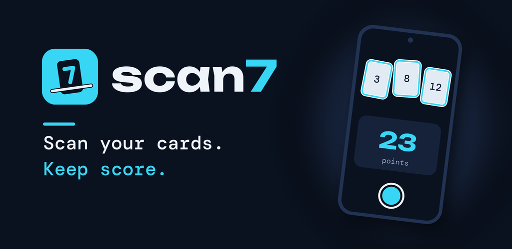
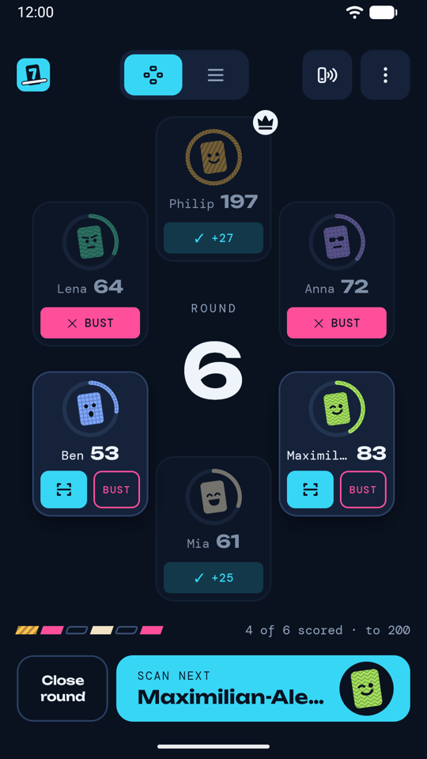
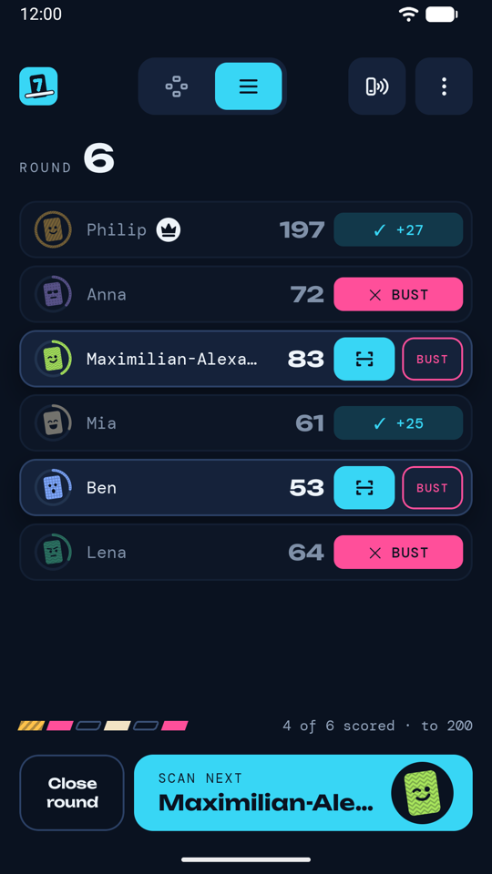
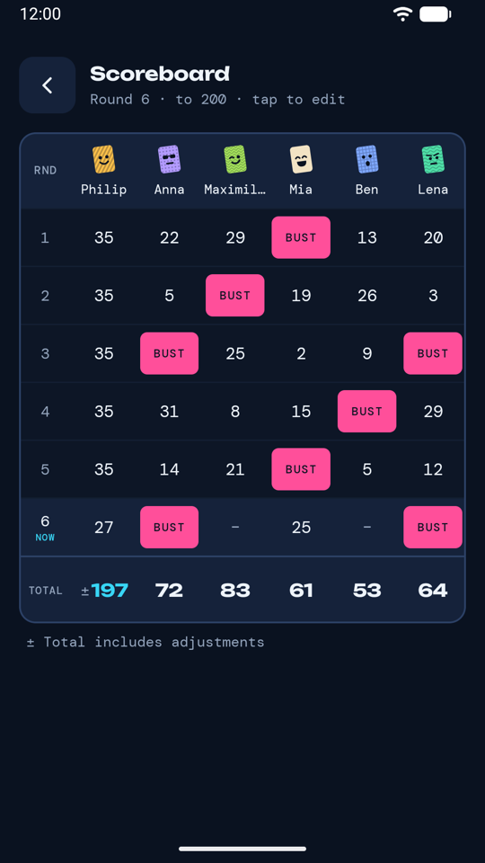
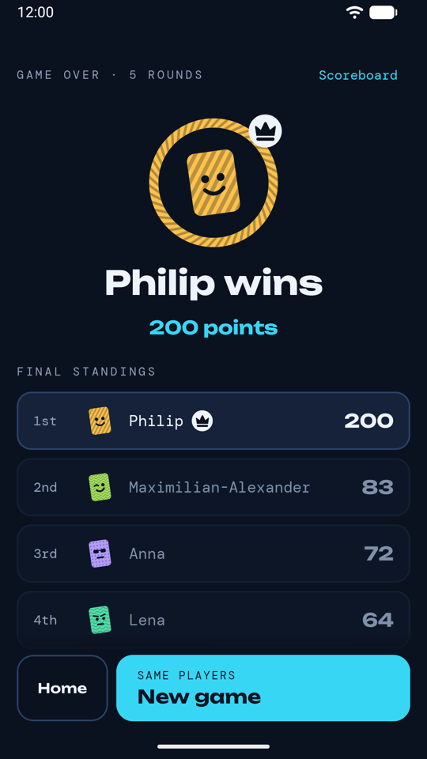
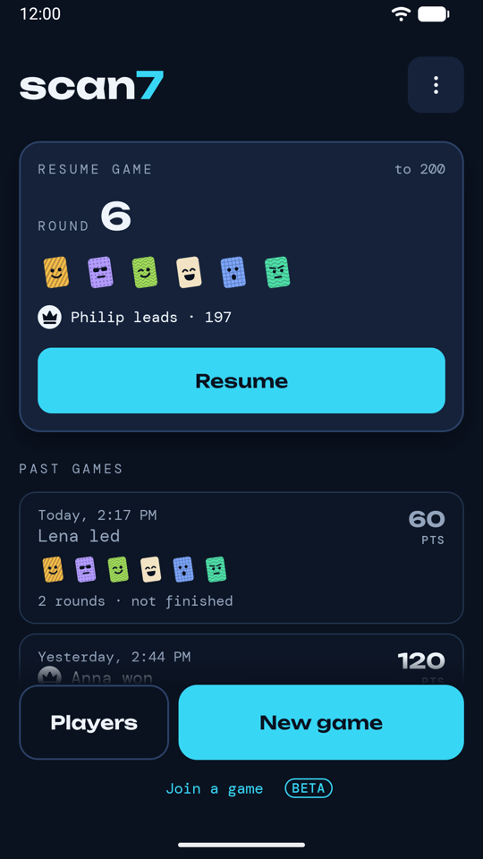

  

  
  
  

# Scan7

An Android score keeper for the card game Flip 7. Point the phone at a player's row of cards, press
the shutter, and Scan7 recognises the cards **on the phone** and adds up the points: number cards,
modifiers, x2 and the Flip 7 bonus. Check the result, fix a card if needed, and go on to the next
player.

- **Fast at the table:** one scan per player, *Scan next* chains the cameras, bust with one tap (with Undo), or enter cards by hand.
- **The whole game:** saved players with avatars, seats like around the real table, running totals, leader, target score, scoreboard and past games.
- **Several phones (beta):** share a game with a QR code; everyone scans their own players, phone to phone over Bluetooth and Wi-Fi.
- **Private:** no account, no ads, no analytics, no internet permission. Photos never leave the phone ([privacy policy](docs/privacy.md)).

  
  
  
  
  

## Download
The signed APK is attached to each [GitHub release](https://github.com/zedoraps/scan7/releases/latest)
(Android 10 or newer). Google Play is coming. The Play and GitHub copies are signed differently, so
one can't update the other.

*Unofficial score keeper for Flip 7. Not affiliated with The Op Games.*

## Development
Building the app, training the detector and the project docs: [docs/dev/DEVELOPMENT.md](docs/dev/DEVELOPMENT.md).
Coding agents start with [AGENTS.md](AGENTS.md).

## License
Scan7 is free software under the **GNU Affero General Public License v3.0** ([LICENSE](LICENSE)):
the app ships a detector trained with Ultralytics YOLO, which is AGPL-3.0. If you distribute a
modified version (or offer it over a network), you must publish its source under the same license.
The Play build links Google Play services (Nearby, for playing on several phones); an additional
permission under AGPL section 7 allows that ([LICENSE-EXCEPTION.txt](LICENSE-EXCEPTION.txt)).
`-Pscan7.foss=true` builds the app without Play services.

Third-party components:

| Component | Used for | License |
|---|---|---|
| [Ultralytics YOLO](https://github.com/ultralytics/ultralytics) (YOLO26n, pretrained weights) | training + the exported detector model | AGPL-3.0 |
| [LiteRT](https://github.com/google-ai-edge/LiteRT) (Google AI Edge) | on-device inference (GPU / CPU) | Apache-2.0 |
| Android Jetpack: Compose, Material 3, CameraX, Room, Lifecycle, Navigation 3, Core, Activity, SplashScreen | app UI, camera, database | Apache-2.0 |
| Kotlin, kotlinx.coroutines, kotlinx.serialization | language + libraries | Apache-2.0 |
| [ZXing](https://github.com/zxing/zxing) core | QR code for joining a shared game | Apache-2.0 |
| Google Play services Nearby (Play build only, not in `-Pscan7.foss=true`) | multiplayer: phone-to-phone connection | proprietary (Google APIs terms) |
| Unbounded, DM Mono fonts | app typography | SIL OFL 1.1 ([docs/third_party/](docs/third_party/)) |

The app shows these notices with the full texts under Home → version footer → *About & licenses*.
Flip 7 is a trademark of its owner and is only named to describe what the app is for; the app uses
none of the game's artwork, logo or fonts. Privacy policy: [docs/privacy.md](docs/privacy.md).
